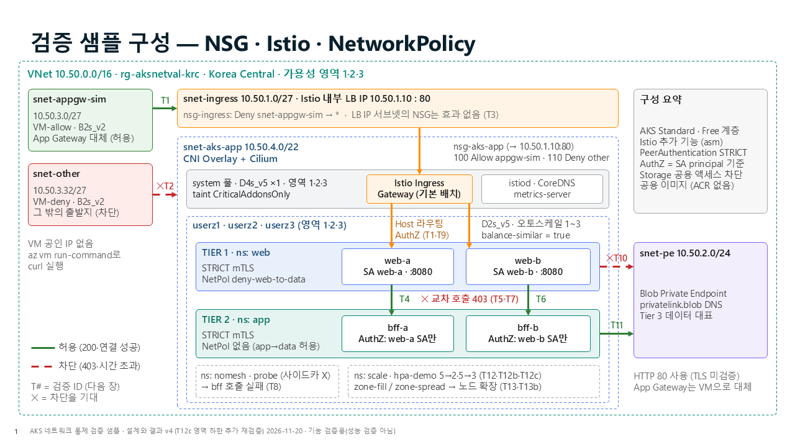
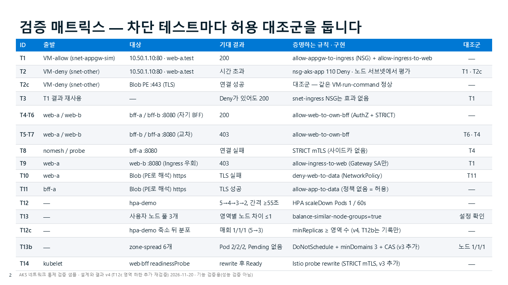
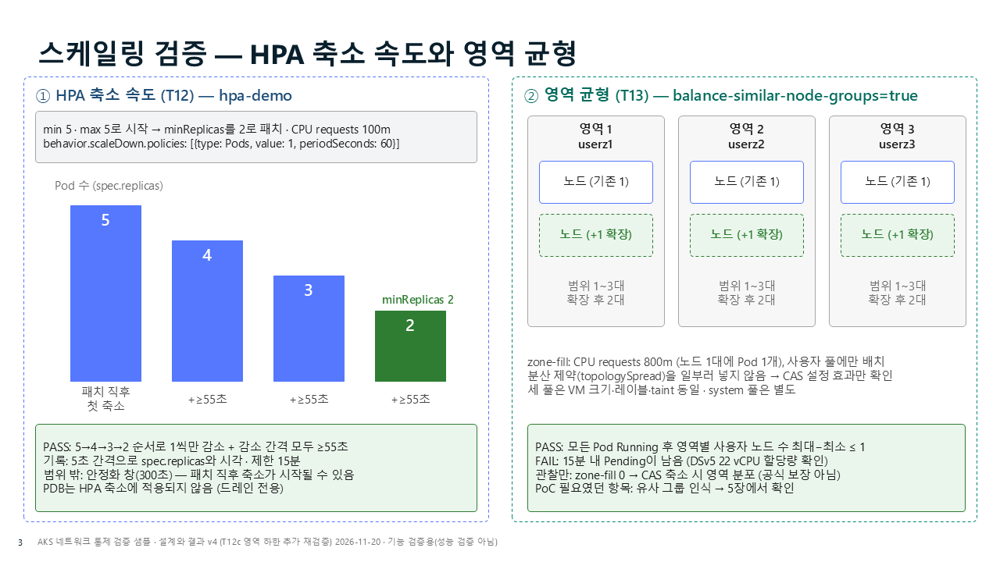
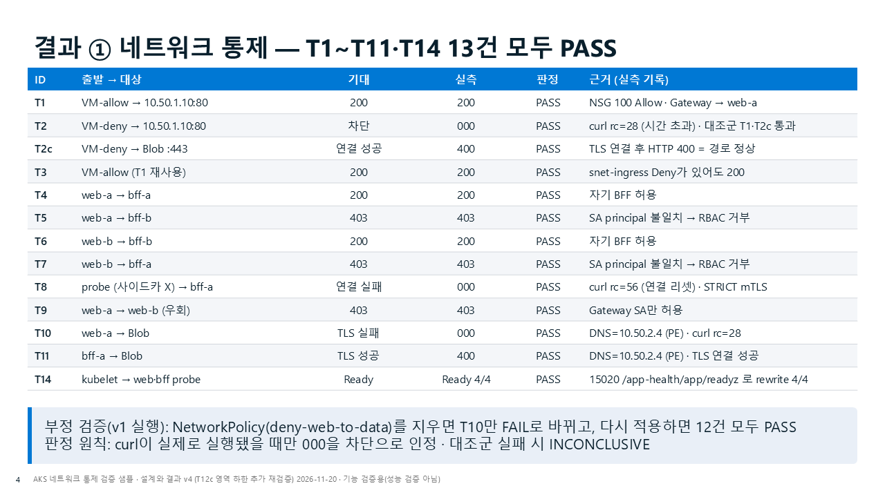
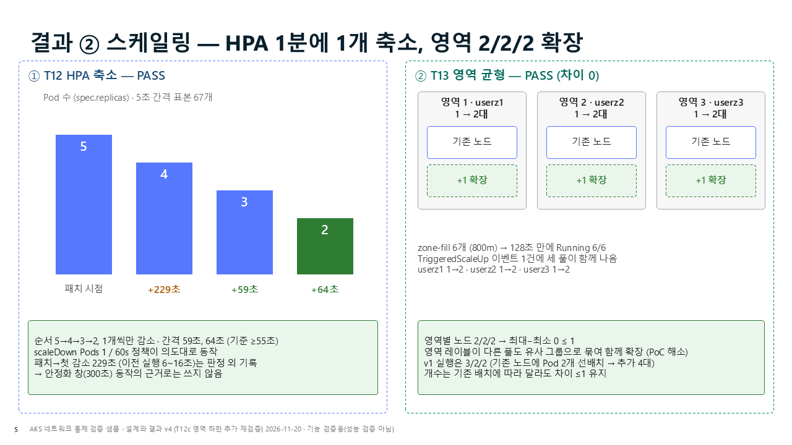
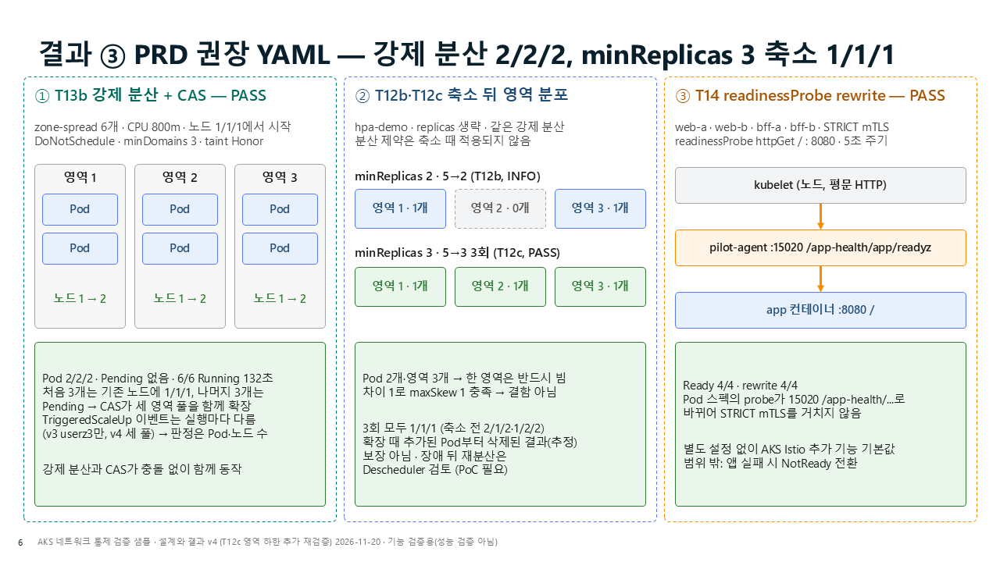
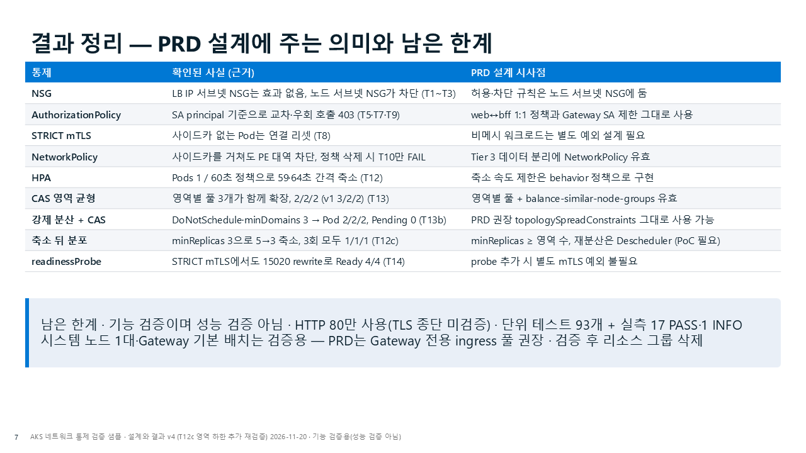

# AKS 네트워크 통제·HPA 축소·영역 균형 기능 검증

AKS 아키텍처 설계에 넣은 통제가 실제로 동작하는지 작은 샘플 클러스터로 검증한 기록입니다. 기능 검증이며, 성능 검증은 아닙니다.

- **네트워크 통제(T1~T11):** NSG, Istio `AuthorizationPolicy`, STRICT mTLS, Cilium `NetworkPolicy`, Blob Private Endpoint
- **HPA 축소 속도(T12):** `spec.behavior.scaleDown.policies`를 Pods 1 / 60초로 설정. Pod 5개가 최소값 2개까지 1분에 1개씩 줄어드는지 확인
- **영역 균형(T13):** 영역별 사용자 노드 풀 3개와 Cluster Autoscaler `balance-similar-node-groups=true`
- **PRD 권장 YAML:** 영역 강제 분산 `DoNotSchedule` + `minDomains: 3`과 CAS 확장(T13b), STRICT mTLS에서 readinessProbe rewrite(T14), `hpa-demo`의 `replicas` 생략
- **축소 뒤 영역 하한(T12c):** `minReplicas: 3`(영역 수)으로 5 → 3 축소를 3회 반복해 매회 세 영역에 Pod가 남는지 판정. 5 → 2 축소 뒤 분포는 기록만 함(T12b)

**결과: 17건 PASS + 기록 1건(T12b INFO)**(2026-11-20, koreacentral). 검증 후 리소스 그룹은 삭제했습니다.

## 저장소 구성

| 경로 | 내용 |
|---|---|
| [`aks-network-validation/`](aks-network-validation/) | 실행 스크립트(01 인프라 → 02 적용 → 03 검증 → 04 정리), 매니페스트, Pester 단위 테스트, [실행 안내 README](aks-network-validation/README.md) |
| [`docs/design-spec.md`](docs/design-spec.md) | 설계 문서: 토폴로지, 주소, 정책, 테스트 매트릭스, 판정 규칙 |
| [`docs/implementation-plan.md`](docs/implementation-plan.md) | 구현 계획(Task 1~6) |
| [`deck/`](deck/) | 설계·결과 장표 PPTX, msdeck YAML 원본, 발표 노트, 렌더링 PNG |
| [`evidence/`](evidence/) | 실측 결과(md/json)와 실행 로그. [색인](evidence/README.md) |

## 장표

[`deck/aksnetval-design-v4.pptx`](deck/aksnetval-design-v4.pptx)(7장). 이미지를 클릭하면 원본 크기로 열립니다.

#### 1. 검증 샘플 구성 — NSG · Istio · NetworkPolicy

<a href="deck/aksnetval-design-v4_render/slide_01.png"></a>

#### 2. 검증 매트릭스 — 차단 테스트마다 허용 대조군을 둡니다

<a href="deck/aksnetval-design-v4_render/slide_02.png"></a>

#### 3. 스케일링 검증 — HPA 축소 속도와 영역 균형

<a href="deck/aksnetval-design-v4_render/slide_03.png"></a>

#### 4. 결과 ① 네트워크 통제 — T1~T11·T14 13건 모두 PASS

<a href="deck/aksnetval-design-v4_render/slide_04.png"></a>

#### 5. 결과 ② 스케일링 — HPA 1분에 1개 축소, 영역 2/2/2 확장

<a href="deck/aksnetval-design-v4_render/slide_05.png"></a>

#### 6. 결과 ③ PRD 권장 YAML — 강제 분산 2/2/2, minReplicas 3 축소 1/1/1

<a href="deck/aksnetval-design-v4_render/slide_06.png"></a>

#### 7. 결과 정리 — PRD 설계에 주는 의미와 남은 한계

<a href="deck/aksnetval-design-v4_render/slide_07.png"></a>

## 검증 구성

```
vnet-aksnetval 10.50.0.0/16 (koreacentral, 영역 1·2·3)
├─ snet-appgw-sim 10.50.3.0/27   VM vm-appgw-sim (Application Gateway 역할, 허용 출발지)
├─ snet-other     10.50.3.32/27  VM vm-other     (차단 대상 출발지)
├─ snet-ingress   10.50.1.0/27   Istio 내부 Ingress Gateway ILB 10.50.1.10 (nsg-ingress)
├─ snet-aks-app   10.50.4.0/22   AKS 노드 (nsg-aks-app: 허용·차단 규칙)
└─ snet-pe        10.50.2.0/24   Blob Private Endpoint 10.50.2.4
```

| 항목 | 값 |
|---|---|
| AKS | Istio 기반 서비스 메시 애드온(리비전 `asm-1-30`), Azure CNI Overlay + Cilium |
| 시스템 풀 | `Standard_D4s_v5` 1대, 영역 1·2·3, `CriticalAddonsOnly` taint. 검증 전용이라 가용성은 없음 |
| 사용자 풀 | `userz1`/`userz2`/`userz3`는 각각 영역 1/2/3, `Standard_D2s_v5`, 오토스케일 1~3 |
| 테스트 VM | `Standard_B2s_v2` 2대, 공인 IP 없음 |
| vCPU | DSv5 22 + BSv2 4 = 26 |
| 워크로드 | `web` 네임스페이스 `web-a`/`web-b` → `app` 네임스페이스 `bff-a`/`bff-b`(1:1 호출), 사이드카 없는 `nomesh/probe` |

## 테스트 매트릭스와 실측 결과

전체 실행 [`evidence/10-v4-full-run_20261120-100357.md`](evidence/10-v4-full-run_20261120-100357.md) 기준입니다. T12c는 전체 실행에서 스크립트 오류로 판정되지 않아, 수정 후 같은 클러스터에서 단독으로 다시 실행한 [`evidence/11-v4-t12c-rerun_20261120-100846.md`](evidence/11-v4-t12c-rerun_20261120-100846.md) 결과입니다.

| ID | 출발 → 대상 | 검증 통제 | 기대 | 실측 | 판정 |
|---|---|---|---|---|---|
| T1 | vm-appgw-sim → 10.50.1.10:80 | NSG 허용, Gateway → web-a | 200 | 200 | PASS |
| T2 | vm-other → 10.50.1.10:80 | NSG 차단 | 차단(000) | 000, curl rc=28(시간 초과) | PASS |
| T2c | vm-other → Blob :443 | T2 대조군(VM 자체 통신 정상) | 연결 성공 | 400(TLS 연결 성공) | PASS |
| T3 | vm-appgw-sim(T1 재사용) | snet-ingress NSG에 Deny가 있어도 효과 없음 | 200 | 200 | PASS |
| T4 | web-a → bff-a | AuthZ 허용(자기 BFF) | 200 | 200 | PASS |
| T5 | web-a → bff-b | AuthZ 거부(SA principal 불일치) | 403 | 403 | PASS |
| T6 | web-b → bff-b | AuthZ 허용 | 200 | 200 | PASS |
| T7 | web-b → bff-a | AuthZ 거부 | 403 | 403 | PASS |
| T8 | nomesh/probe → bff-a | STRICT mTLS | 연결 실패 | 000, curl rc=56(연결 리셋) | PASS |
| T9 | web-a → web-b(Gateway 우회) | AuthZ: Gateway SA만 허용 | 403 | 403 | PASS |
| T10 | web-a → Blob PE | NetworkPolicy로 Tier 3 차단 | TLS 실패 | 000, DNS=10.50.2.4, rc=28 | PASS |
| T11 | bff-a → Blob PE | T10 대조군 | TLS 성공 | 400, DNS=10.50.2.4 | PASS |
| T12 | HPA minReplicas 5 → 2 | scaleDown Pods 1 / 60s | 5→4→3→2, 간격 55초 이상 | 5,4,3,2, 간격 59초·64초 | PASS |
| T12b | T12 축소 전·후 `hpa-demo` 분포 | 2개로 줄인 뒤 분포 기록 | 기록(판정 없음) | 2/1/2 → 1/0/1 | INFO |
| T12c | `hpa-demo` minReplicas 5 → 3, 3회 | 영역 수만큼 남기면 영역마다 1개 이상 | 매회 세 영역 모두 ≥1 | 2/1/2→**1/1/1**, 1/2/2→**1/1/1**, 1/2/2→**1/1/1** | PASS |
| T13 | `zone-fill` 6개(800m) | CAS 영역 균형 | 영역별 노드 차이 1 이하 | 1/1/1 → 2/2/2, 128초 만에 6개 모두 Running | PASS |
| T13b | `zone-spread` 6개(800m, DoNotSchedule, minDomains 3) | 강제 분산 + CAS | Pod 2/2/2, Pending 없음 | Pod 2/2/2, 노드 1/1/1 → 2/2/2, 132초 | PASS |
| T14 | kubelet → web·bff readinessProbe | Istio probe rewrite(STRICT mTLS) | rewrite 후 Ready | Ready 4/4, `15020 /app-health/app/readyz` 4/4 | PASS |

T13의 근거는 TriggeredScaleUp 이벤트 1건입니다. 한 번의 확장에서 `userz1/2/3 1->2`가 함께 일어났습니다. 이벤트는 Pod별로 중복 제거되어 일부만 보일 수 있으므로 T13b는 Pod·노드 수로만 판정합니다.

T12b의 1/0/1은 Pod 2개를 세 영역에 둔 결과라 한 영역이 비는 것이 당연하고, 차이 1은 `maxSkew: 1`도 만족합니다. 그래서 기록만 하고 영역 하한은 T12c로 판정합니다.

### 판정 원칙

- 판정은 `PASS`, `FAIL`, `INCONCLUSIVE` 세 가지이고, 관찰만 하는 T12b는 `INFO`입니다.
- T12c는 3회 중 한 번이라도 빈 영역이 있으면 FAIL, Running이 3개가 아니면 `INCONCLUSIVE`입니다.
- 대조군(T1, T2c, T4, T6, T11)이 실패하면 해당 차단 테스트는 `INCONCLUSIVE`입니다.
- 차단 기대(000)는 curl이 실제로 실행됐을 때만 인정합니다. exec나 run-command가 실패했거나 `rc=126/127`이면 `INCONCLUSIVE`입니다.
- Blob FQDN이 사설 IP로 해석되지 않으면 T10·T11은 `INCONCLUSIVE`입니다.
- T13은 Pending Pod가 남으면 FAIL입니다. 노드가 늘지 않았거나 시작 상태(풀마다 1대)를 만들지 못하면 `INCONCLUSIVE`입니다.
- T13b는 노드 1/1/1에서 시작해 15분 안에 Pending 없이 영역별 Pod 수 차이가 1 이하면 PASS, Pending이 남으면 FAIL입니다.
- T14는 probe 없음, rewrite 안 됨, Not Ready 중 하나라도 있으면 FAIL입니다.

## 확인된 사실과 PRD 시사점

| 통제 | 확인된 사실 | 설계 시사점 |
|---|---|---|
| NSG | ILB가 있는 서브넷의 NSG는 효과가 없고, 노드 서브넷 NSG가 차단(T1~T3) | 허용·차단 규칙은 노드 서브넷 NSG에 둠 |
| AuthorizationPolicy | SA principal 기준으로 교차 호출과 우회 호출이 403(T5·T7·T9) | web↔bff 1:1 정책과 Gateway SA 제한을 그대로 사용 |
| STRICT mTLS | 사이드카 없는 Pod는 연결이 리셋됨(T8) | 메시 밖 워크로드는 별도 예외 설계 필요 |
| NetworkPolicy | 사이드카를 거쳐도 PE 대역이 차단되고, 대조군 bff-a는 접근 가능(T10·T11) | Tier 3 데이터 분리에 NetworkPolicy가 유효 |
| HPA | Pods 1 / 60초 정책으로 약 60초 간격으로 축소(T12) | 축소 속도 제한은 `behavior` 정책으로 구현 |
| CAS 영역 균형 | 영역 레이블이 다른 풀도 유사 그룹으로 묶여 함께 확장, 1/1/1 → 2/2/2(T13) | 영역별 풀 + `balance-similar-node-groups` 조합이 유효 |
| 강제 분산 + CAS | `DoNotSchedule`·`minDomains: 3`에서 Pending Pod를 보고 CAS가 세 영역을 확장, Pod 2/2/2(T13b) | PRD 권장 `topologySpreadConstraints`를 그대로 사용 가능 |
| 축소 뒤 분포 | `minReplicas: 3`으로 5 → 3 축소, 3회 모두 1/1/1(T12c) | `minReplicas` ≥ 영역 수(3) 권장. 장애 뒤 재분산은 Descheduler 검토(PoC 필요) |
| readinessProbe | STRICT mTLS에서도 `15020 /app-health/...` rewrite로 Ready(T14) | probe를 추가해도 별도 mTLS 예외 불필요 |

## 한계

- 기능 검증이며 성능 검증은 아닙니다. HTTP 80만 사용했고 TLS 종단은 검증하지 않았습니다.
- T12는 축소 속도 정책만 검증합니다. 안정화 창(300초)은 검증하지 않습니다.
- T13은 확장만 판정하고 축소는 관찰만 합니다. 영역별 정확한 노드 수는 기존 Pod 배치에 따라 달라질 수 있습니다.
- T14는 rewrite된 probe로 Ready가 되는 것만 확인합니다. 앱이 실패할 때 NotReady로 바뀌는 음성 시나리오는 검증하지 않습니다.
- T12c의 1/1/1은 3회 관찰이지 보장이 아닙니다. 분산 제약은 축소 때 적용되지 않고, 어느 Pod가 지워지는지는 ReplicaSet 규칙(같은 노드에 몰린 Pod, 최근 생성 Pod 우선 등)에 따릅니다. 확장 때 추가된 Pod부터 지워진 결과로 해석합니다(추정).
- T12의 패치 후 첫 감소 시간(229초)은 판정 외 값이며 안정화 창 동작의 근거로 쓰지 않습니다.
- 시스템 노드 1대와 Gateway 기본 배치는 검증용 구성입니다. PRD에서는 Gateway 전용 `ingress` 풀을 권장합니다.
- 로그의 로컬 경로는 `<repo>`로, Storage 계정 이름은 `staksnetval<hash>`로 마스킹했습니다.

## 재현

Windows PowerShell 7, Azure CLI, kubectl, Pester 5.5 이상이 필요합니다. 자세한 내용은 [`aks-network-validation/README.md`](aks-network-validation/README.md)를 보세요.

```powershell
cd aks-network-validation
Invoke-Pester ./tests          # 단위 테스트 93개
./01-infra.ps1                 # 약 25분
./02-apply.ps1                 # 약 5분
./03-verify.ps1                # T1~T14, 약 30~55분 (-Only Network|Hpa|Floor|Zone|Spread)
./04-cleanup.ps1               # 리소스 그룹 삭제
```
